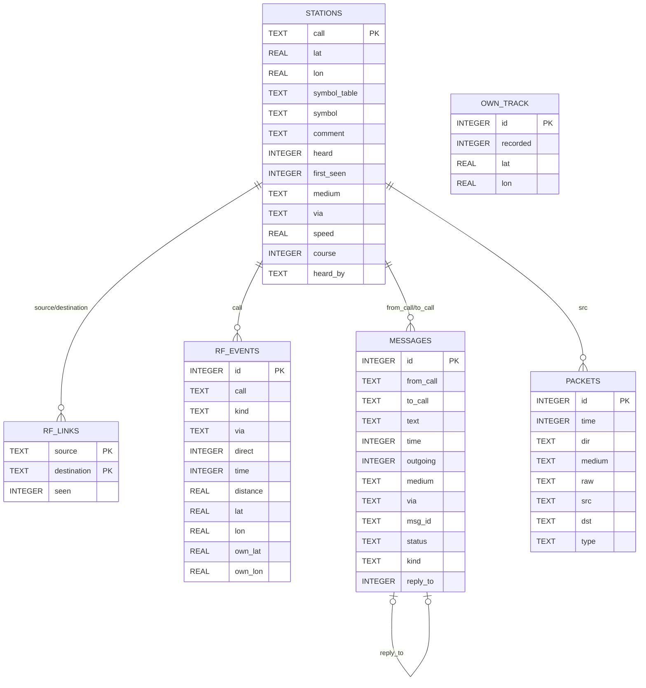

# Modelo de Dados Completo (ERD)

> Gerado pelo Arquiteto (Reversa) em 2026-11-27. Não há chaves estrangeiras declaradas; as relações abaixo são lógicas (pelo indicativo). 🟡

| Banco | Tabelas | Versão | Retenção |
|-------|---------|--------|----------|
| `stations.db` | stations, rf_links, own_track, rf_events | 3 | 30 d / 30 d / 7 d (config.) / 365 d |
| `messages.db` | messages | 1 | por categoria (padrão sem prazo, 5000) |
| `packets.db` | packets | 2 | 7 d / 20.000 linhas (config.) |

Armazenamento fora do SQLite: SharedPreferences `pt2vhf_aprs` (configurações, favoritas, objetos em JSON, snapshots de perfil) e `filesDir/routes.json`. Detalhes em `data-dictionary.md`.
