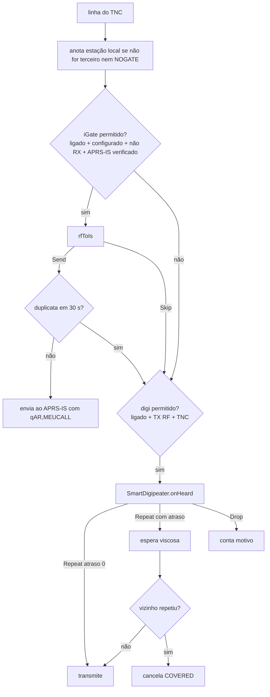
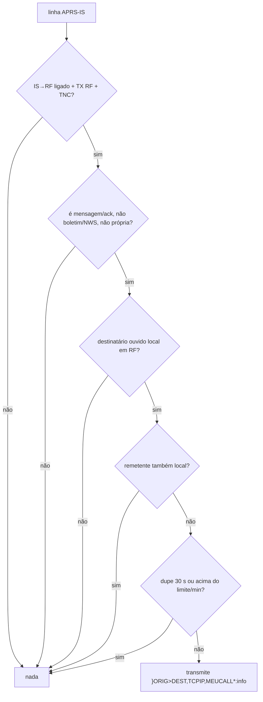

# Fluxograma — gateway-igate-digi

> Arqueólogo, 2026-11-27. 🟢 `core/Igate.kt`, `core/SmartDigipeater.kt`, `service/AprsService.kt:931-1005`.

## Pacote ouvido no TNC

## Linha do APRS-IS (IS→RF)

