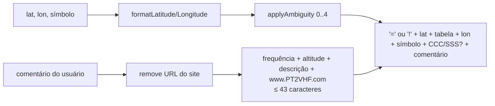

# Fluxograma — protocolo-aprs

> Arqueólogo, 2026-11-27. 🟢 extraído de `core/Aprs.kt`, `core/AprsDevice.kt`, `core/AprsExtras.kt`.

## Recepção: linha TNC2 → dados

```mermaid
flowchart TD
    A[Linha TNC2] --> B{vazia ou começa com #?}
    B -- sim --> X[ignorar]
    B -- não --> C{tem '>' antes de ':'?}
    C -- não --> X
    C -- sim --> D{info começa com '}'?}
    D -- sim, profundidade 0 --> E[parse do cabeçalho interno<br/>thirdPartyGateway = origem externa]
    D -- sim, profundidade 1 --> X
    D -- não --> F[AprsPacket]
    E --> F
    F --> G{packetType info}
    G -- position/weather --> H[parsePosition<br/>não comprimida]
    G -- mice --> I[parseMicE destino+info]
    G -- object/item --> J[parseObject]
    G -- message/ack/bulletin --> K[parseMessage]
    G -- telemetry --> L[parseTelemetryFrame / definições]
    G -- outros --> M[sem decodificação]
    H --> N[parseAprsWeather se símbolo '_']
```

## Transmissão: beacon


