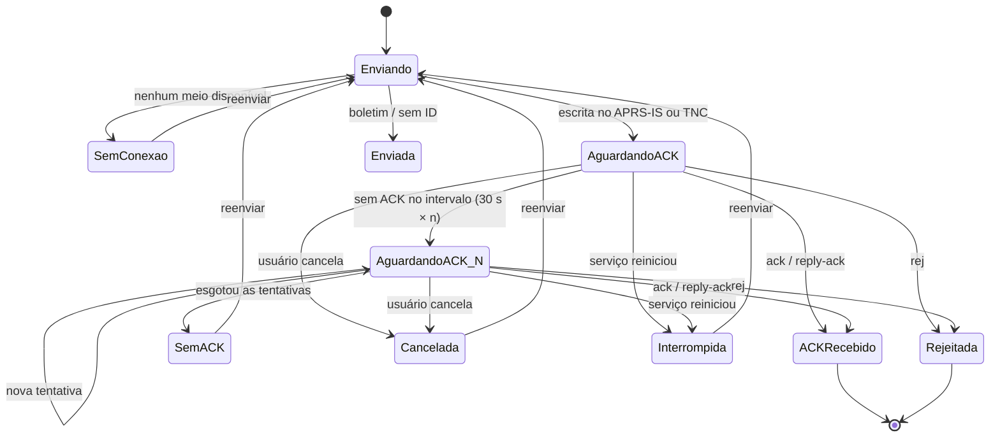
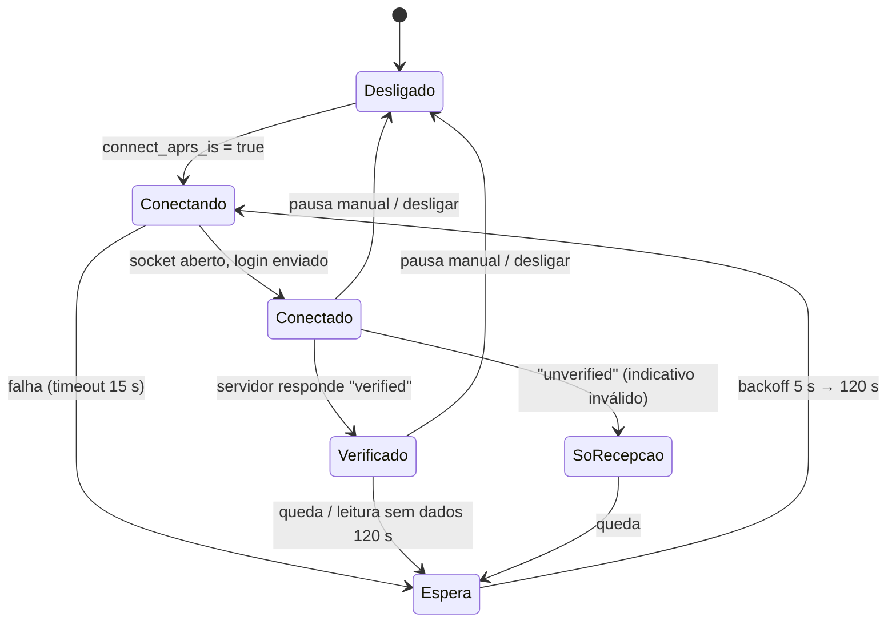
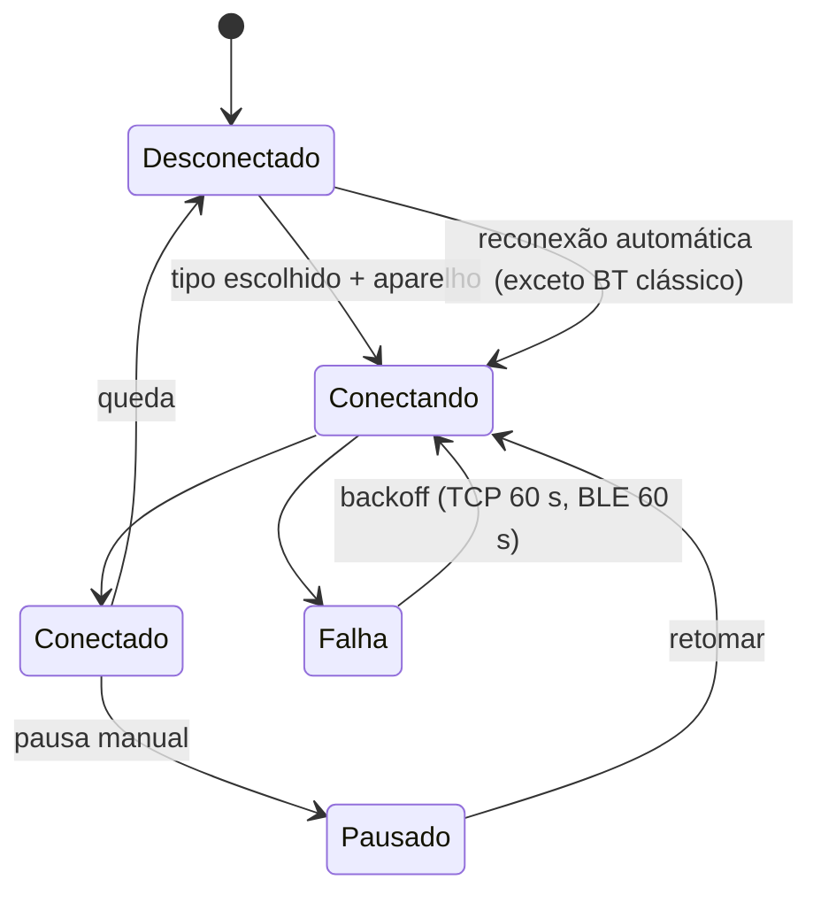
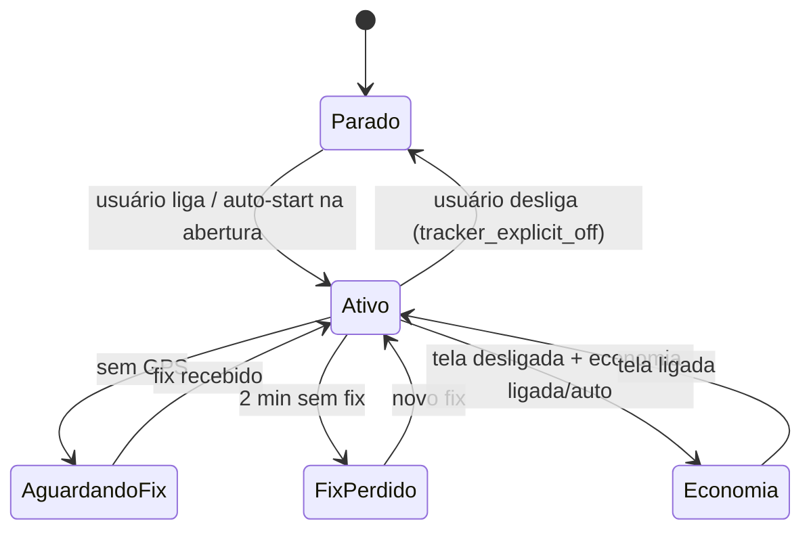
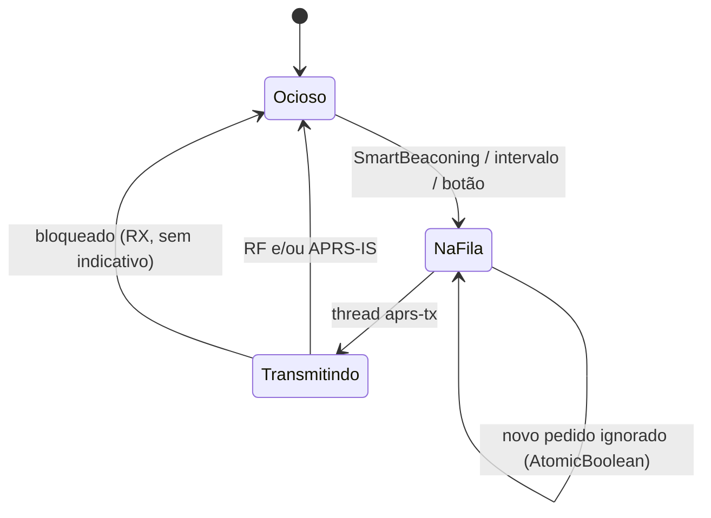
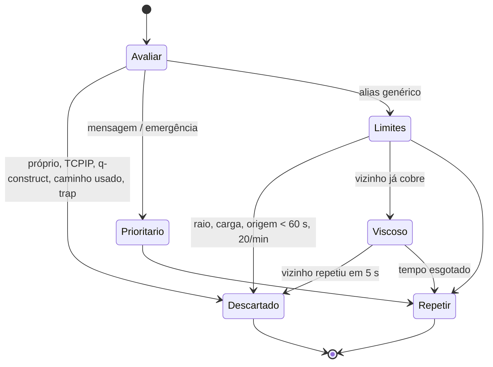

# Máquinas de Estado — PT2VHF-APRS-Android

> Gerado pelo Detetive (Reversa) em 2026-11-27.

## 1. Situação de mensagem enviada 🟢

Valores gravados (`InternalText`): `Enviando`, `Enviada · <meio>`, `Aguardando ACK · <meio>`, `Aguardando ACK (Nª tentativa)`, `ACK recebido`, `Rejeitada`, `Sem conexão para enviar`, `Sem ACK após N tentativas`, `Cancelada`, `Interrompida`. Mensagem recebida: `Recebida`.

## 2. Conexão APRS-IS 🟢

## 3. Conexão TNC 🟢

Observação: o Bluetooth clássico (SPP) não volta sozinho para `Conectando` (ponto de atenção A2).

## 4. Tracker (beacon automático) 🟢

## 5. Ciclo do envio de beacon 🟢

## 6. Pacote no digipeater 🟢

## 7. Notificação de atualização 🟢

`Sem consulta` → `Consultando` (1 h ao voltar, 12 h em segundo plano) → `Sem novidade` | `Nova versão` (notifica uma vez por versão) | `Falha` (tenta de novo em 30 min).
